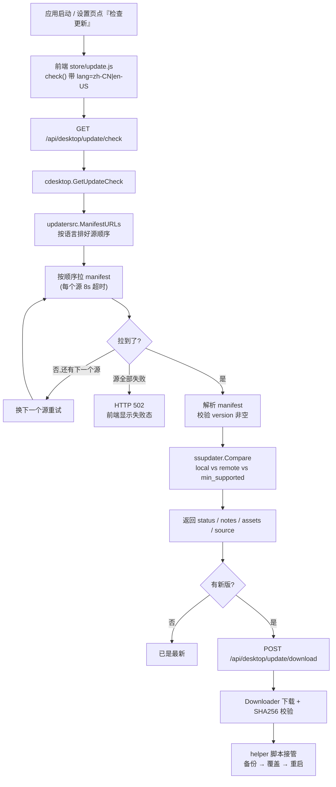
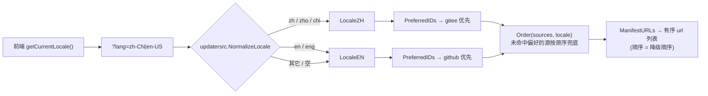
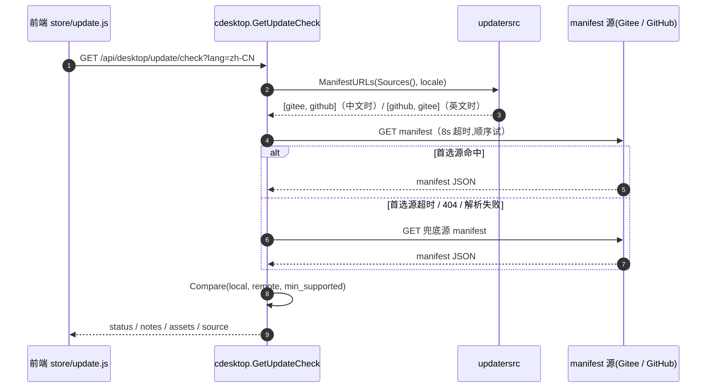
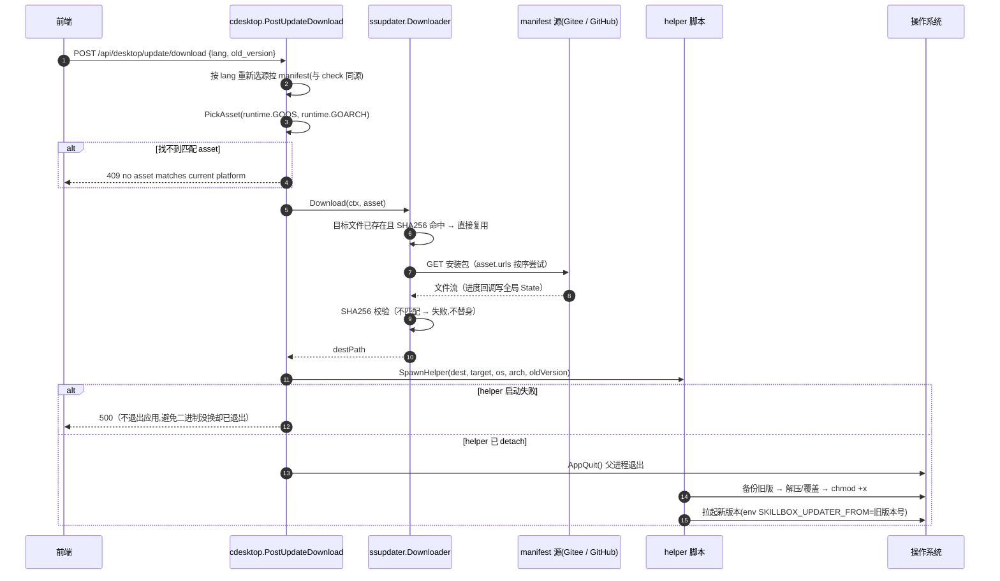
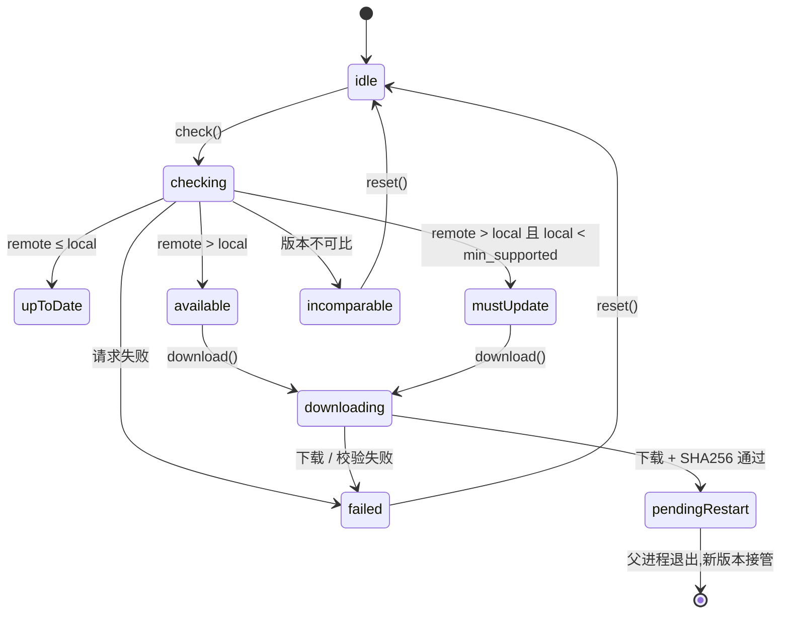
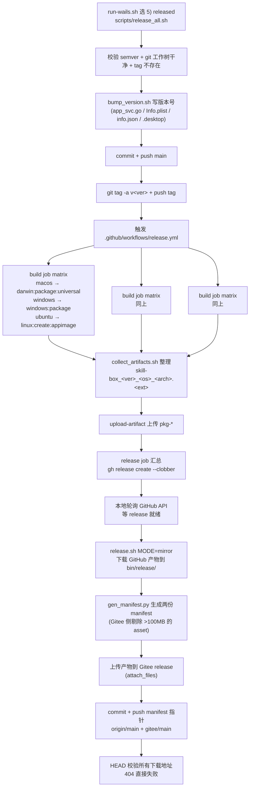

# 软件更新机制(应用自升级)

> 讲清楚三件事:**新版本信息从哪来**(选源)、**怎么判断有没有新版本**(check)、
> **怎么把新版装上去**(download + 替身脚本)。2026-10-30 起支持"按用户语言分源":
> **中文用户走 Gitee,英文用户走 GitHub**。

---

## 1. 全景

三个概念先对齐:

| 概念             | 是什么                                                                 | 落在哪                                        |
| ---------------- | ---------------------------------------------------------------------- | --------------------------------------------- |
| **更新源(source)** | 一个托管站(Gitee / GitHub),既放 manifest 也放安装包                   | `api-server/pkg/updatersrc`                   |
| **manifest**     | 一份 JSON:最新版本号 + 各平台安装包的下载地址/大小/SHA256            | `build/updater/manifest.{github,gitee}.json`  |
| **asset**        | manifest 里的一个平台安装包条目(`os` / `arch` / `kind` / `urls` / `sha256`) | manifest 的 `assets[]`                        |

> 客户端**不知道最新版本号**,所以 manifest 必须放在一个固定 URL 上(分支 raw)。
> 两个站各放一份,内容除 `assets[].urls` 指向各自站点外完全一致。



---

## 2. 选源规则(按语言)

| 用户语言          | 首选源  | 兜底源  |
| ----------------- | ------- | ------- |
| `zh-CN`(及 zh 前缀)| **Gitee** | GitHub  |
| `en-US`(及 en 前缀)| **GitHub** | Gitee  |
| 未知 / 未传 `lang` | GitHub  | Gitee  |



**代码位置**

| 关注点             | 位置                                                            |
| ------------------ | --------------------------------------------------------------- |
| 源注册表 / 语言归一化 / 排序 | `api-server/pkg/updatersrc/updatersrc.go`              |
| 默认源地址         | `updatersrc.DefaultSources()`                                   |
| env 覆盖           | `SKILLBOX_UPDATER_SOURCES="gitee=<url>,github=<url>"`(新)<br>`SKILLBOX_UPDATER_URLS="<url1>,<url2>"`(旧,兼容) |
| 桌面端注入         | `desktop/services/updater_helper.go` → `BootstrapHooks.UpdaterManifestURLs` |

> 选源逻辑放在 `pkg/` 而不是 `internal/`:桌面端模块(`skill-box`)与后端模块(`ginp-api`)
> 要用同一份实现,而 Go 的 internal 规则禁止跨模块 import internal 包。

---

## 3. 检查更新(check)



**端点**

| 端点                                       | 方法 | 入参              | 说明                                  |
| ------------------------------------------ | ---- | ----------------- | ------------------------------------- |
| `/api/desktop/update/check`                | GET  | `lang`(query)     | 查最新版本,返回比对结论与 asset 列表 |
| `/api/desktop/update/state`                | GET  | 无                | 下载阶段 / 进度轮询                   |
| `/api/desktop/update/download`             | POST | `lang` / `old_version` / `asset_index` | 桌面端:下载 + 触发替身脚本 + 退出 |

**响应关键字段**

| 字段           | 类型   | 说明                                                        |
| -------------- | ------ | ----------------------------------------------------------- |
| `status`       | string | `upToDate` / `available` / `mustUpdate` / `incomparable`     |
| `local_version`| string | 本地版本(桌面端 ldflags 注入;Web 端 `0.0.0+web`)            |
| `remote_version`| string | manifest 里的最新版本                                        |
| `notes`        | object | 多语言更新说明,按当前 locale 取                               |
| `assets`       | array  | 各平台安装包(含 `urls` 与 `sha256`)                           |
| `source`       | string | **实际命中的源**(`gitee` / `github`),排查用                  |

**版本比对规则**(`ssupdater.Compare`,用 `golang.org/x/mod/semver`)

| 条件                                        | `status`        | 前端表现         |
| ------------------------------------------- | --------------- | ---------------- |
| `remote > local` 且 `local >= min_supported`| `available`     | 显示"立即升级"   |
| `remote > local` 且 `local < min_supported` | `mustUpdate`    | 强制升级提示     |
| `remote <= local`(含降级场景)              | `upToDate`      | 不弹升级         |
| 任一侧不是合法 semver                       | `incomparable`  | 显示"无法比较"   |

---

## 4. 下载与替换(download)



**替身脚本三平台行为**(随 binary `//go:embed`,父进程退出后由脚本接管)

| 平台             | 脚本                   | 支持的产物形态                     | 覆盖目标                          |
| ---------------- | ---------------------- | ---------------------------------- | --------------------------------- |
| macOS            | `helper_darwin.sh`     | `.zip`(找 `.app`)/ `.dmg`(mount)  | `/Applications/SkillBox.app`      |
| Windows          | `helper_windows.ps1`   | `.zip`(内含 `skill-box.exe`)       | 与 app.exe 同目录                 |
| Linux            | `helper_linux.sh`      | `.AppImage` / `.tar.gz` / 裸二进制 | `~/.local/bin/skill-box`          |

**下载器要点**(`ssupdater/download.go`)

- 目标文件已存在且 SHA256 命中 → **跳过下载**,直接进校验通过态(典型续传命中);
- `asset.urls` 数组按序尝试,某个源失败自动换下一个;
- 下载完**强制 SHA256 校验**,不匹配直接失败(**不替身**);
- 进度通过全局 `State` 暴露,前端 `GET /api/desktop/update/state` 每 2s 轮询;
- HTTP Range 续传目前是**预留钩子**(`maybeResume` 未实现),MVP 走整段下载。

---

## 5. manifest 格式

```json
{
  "channel": "stable",
  "version": "1.2.3",
  "released_at": "2026-10-30T08:50:12Z",
  "min_supported": "1.0.0",
  "notes": { "zh-CN": "Release 1.2.3", "en-US": "Release 1.2.3" },
  "assets": [
    {
      "os": "darwin",
      "arch": "arm64",
      "kind": "app",
      "size": 1175,
      "sha256": "ff513683…",
      "urls": [
        "https://gitee.com/dicoder/skill-box/releases/download/v1.2.3/skill-box_1.2.3_darwin_universal.zip"
      ]
    }
  ]
}
```

| 字段            | 说明                                                        |
| --------------- | ----------------------------------------------------------- |
| `version`       | 严格 semver `MAJOR.MINOR.PATCH[-prerelease]`               |
| `min_supported` | 低于此版本 → 前端提示必须升级                              |
| `notes`         | 多语言更新说明,key 命中前端 locale                         |
| `assets[].urls` | 下载地址数组,**顺序即降级顺序**;单源时只有一个元素          |
| `assets[].sha256`| **强约束**,下载完校验,不匹配不安装                        |

> schema 详见 [`../../agent/project/updater-manifest.md`](../../agent/project/updater-manifest.md)(运维视角)。

---

## 6. 前端状态机



- 状态机实现:`frontend/src/core/store/update.js`
- 界面位置:设置页 → **软件更新**卡片(`frontend/src/components/update/UpdatePanel.vue`)
- 触发时机:应用启动(`App.vue` onMounted)自动查一次 + 设置页"检查更新"按钮
- 卡片上会显示**更新源**(Gitee / GitHub),便于排查"为什么下载这么慢"

---

## 7. 发布流程

本地是 macOS,交叉编译链(CGO / NSIS / AppImage)在 mac 上不可用,
所以**三平台统一由 GitHub Actions 打**,产物在 GitHub release 上汇合,
再由本地脚本下载 → 同步到 Gitee → 生成并推送两份 manifest 指针。

入口:`run-wails.sh` 选 `5) released` → `scripts/release_all.sh`。

### 7.1 全景



### 7.2 三平台产物对照

| 平台 | CI 任务                             | 产物名                                              | 进 manifest |
| ---- | ----------------------------------- | --------------------------------------------------- | ----------- |
| mac  | `wails3 task darwin:package:universal` | `skill-box_<ver>_darwin_universal.zip`            | ✅          |
| win  | `wails3 task windows:package`       | `skill-box_<ver>_windows_amd64.zip`                   | ✅          |
| win  | 同上                                | `skill-box_<ver>_windows_amd64-installer.exe`        | ❌ 仅手动下载 |
| linux| `wails3 task linux:create:appimage` | `skill-box_<ver>_linux_{amd64,arm64}.AppImage`       | ✅          |

- mac 的 universal 包在 manifest 里**登记 arm64 + amd64 两条 entry**,指向同一个 zip;
- `.dmg` / `*-installer.exe` 替身脚本装不了,**只当 release 附件供手动下载**,不进 `assets[]`;
- Gitee 单附件 100MB → mac/win 统一压 zip;仍超限的 asset **只进 GitHub 那份 manifest**。

### 7.3 脚本职责

| 脚本                             | 谁调用                       | 职责                                                 |
| -------------------------------- | ---------------------------- | ---------------------------------------------------- |
| `scripts/release_all.sh`         | `run-wails.sh` 选 5          | 一键编排:版本号 → bump → tag → 等 CI → mirror        |
| `scripts/release.sh`             | `release_all.sh`             | `MODE=build` 本地构建发双站 / `MODE=mirror` 拉产物同步 Gitee |
| `scripts/bump_version.sh`       | release_all / release.sh / CI | 统一写各平台版本号(PlistBuddy 不存在时退回 sed)      |
| `scripts/collect_artifacts.sh`   | CI 三平台各一次              | 把 wails3 产物整理成发布命名约定                      |
| `scripts/gen_manifest.py`        | `release.sh`                 | 生成 `manifest.github.json` / `manifest.gitee.json`   |

### 7.4 发布 env

| env                   | 默认值                  | 说明                                        |
| --------------------- | ----------------------- | ------------------------------------------- |
| `VERSION`             | 交互输入                | 严格 semver                                 |
| `CHANNEL`             | `stable`                | 渠道                                        |
| `WAIT_TIMEOUT`        | `3600`                  | 等 CI 的秒数(release_all.sh)                |
| `DRY_RUN=1`           | `0`                     | 只跑到"生成 manifest",不推不传(演练)       |
| `NO_PUSH=1`           | `0`                     | 跑完但不调上传 API                         |
| `GITHUB_REPO`         | `dicoder-dev/skill-box` |                                            |
| `GITHUB_TOKEN`        | 空                      | 需要仓库写权限                             |
| `GITEE_REPO`          | `dicoder/skill-box`     | 必须是**已存在的公开仓库**                  |
| `GITEE_USER`          | `dicoder`               | 推代码时拼 URL 用                           |
| `GITEE_TOKEN`         | 空                      | 需要仓库写权限                             |
| `GITEE_BRANCH`        | `main`                  | **必须是 Gitee 仓库的实际分支**,否则 raw 404 |
| `GITEE_MAX_ATTACH_MB` | `100`                   | Gitee 单附件上限,超限的包只进 GitHub        |

Token 读取顺序:环境变量 → `~/.skill-box/release.env` → 交互输入(不回显,自动记住)。

### 7.5 首次发版前置条件

- GitHub 仓库 `dicoder-dev/skill-box` 已开启 Actions 权限(工作流需要 `contents: write`);
- Gitee 仓库 `dicoder/skill-box` **已创建**,默认分支是 `main`(否则 raw 404,用 `GITEE_BRANCH` 覆盖);
- `GITHUB_TOKEN` / `GITEE_TOKEN` 已备好(建议写在 `~/.skill-box/release.env`,权限 600);

---

## 8. 代码地图

| 层        | 文件                                                          | 职责                                   |
| --------- | ------------------------------------------------------------- | -------------------------------------- |
| 选源      | `api-server/pkg/updatersrc/updatersrc.go`                     | 源注册表 / 语言归一化 / 按语言排序      |
| 拉 manifest | `api-server/internal/gapi/service/updater/ssupdater/manifest.go` | 多源拉取 + 降级 + 缓存 + 命中源回传  |
| 源默认值  | `api-server/internal/gapi/service/updater/ssupdater/urls.go`  | hooks 注入优先,否则走 updatersrc       |
| 版本比对  | `api-server/internal/gapi/service/updater/ssupdater/compare.go` | semver 比对,产出 status               |
| 下载校验  | `api-server/internal/gapi/service/updater/ssupdater/download.go` | 下载 / 进度 / SHA256                  |
| HTTP 端点 | `api-server/internal/gapi/controller/skillbox/cdesktop/update.a.go` | check / state / download            |
| 桌面注入  | `desktop/services/updater_helper.go`                          | manifest url 导出 + helper 脚本 embed  |
| 替身脚本  | `desktop/services/updater_scripts/helper_*.{sh,ps1}`           | 备份 / 覆盖 / 重启                     |
| 前端状态  | `frontend/src/core/store/update.js`                           | 状态机 + 请求参数                      |
| 前端界面  | `frontend/src/components/update/UpdatePanel.vue`              | 更新卡片                                |
| 发版编排  | `scripts/release_all.sh`                                     | 版本号 → bump → tag → 等 CI → 同步 Gitee |
| 发布脚本  | `scripts/release.sh`                                         | MODE=build 本地发 / MODE=mirror 同步 Gitee |
| 版本号    | `scripts/bump_version.sh`                                    | 各平台版本号统一写入                 |
| 产物整理  | `scripts/collect_artifacts.sh`                               | wails3 产物 → 发布命名约定           |
| manifest  | `scripts/gen_manifest.py`                                    | 生成两份 manifest 指针                |
| CI        | `.github/workflows/release.yml`                              | 三平台矩阵构建 + GitHub Release      |

---

## 9. 容错与降级矩阵

| 故障点                     | 表现                        | 兜底                                        |
| -------------------------- | --------------------------- | ------------------------------------------- |
| 首选 manifest 源超时/404   | 换兜底源重试(顺序降级)     | 另一站同一份 manifest                      |
| 所有源都失败               | HTTP 502,前端显示失败态     | 用户可手动"重置"后重试                     |
| manifest 缺 `version`      | 视为无效,继续下一个源      | 同上                                        |
| 安装包某个 URL 404/超时    | 换 `urls` 里的下一个        | 单源时直接失败                             |
| SHA256 不匹配              | 拒绝安装,报"校验失败"      | 不安装、不替身、保留已下载文件供排查       |
| helper 脚本启动失败        | HTTP 500,**不退出应用**    | 用户仍在旧版本,不会"没换成功却已退出"      |
| Gitee 附件超 100MB         | 该 asset 只进 GitHub        | 中文用户从 GitHub 拿该包                   |

---

## 10. 已知限制 / 坑

- **GitHub 上目前 0 个 release / 0 个 tag**,Gitee 上也还没有 `dicoder/skill-box` 仓库
  → 首次正式发版前要先建 Gitee 仓库(默认分支 `main`)并推 GitHub 镜像;
- **发版强依赖 GitHub Actions 跑通**:CI 失败 → release_all.sh 会在等超时后报错退出,
  此时 tag 已经打上去了,需要人工删 tag 重打(改用别的版本号重发);
- **Gitee 新建仓库默认分支可能是 `master`**,raw 地址里的分支名写错直接 404 → 用 `GITEE_BRANCH` 覆盖;
- **Gitee 没有 `releases/latest/download/<file>` 的保证** → 版本指针统一用分支 raw;
- **Gitee raw 会 302 跳转**到真实文件地址,Go http.Client 默认跟随,无需特殊处理;
- **manifest 缓存 5 分钟**,缓存键含源地址列表 → 切语言后会重新拉对应源的 manifest,不会串源;
- **Windows 自升级只支持 zip**(helper 不认 nsis 安装包);nsis 安装包仅作手动下载;
- **HTTP Range 真续传未实现**(`maybeResume` 是空钩子),中断后是整段重下;
- **manifest 里 `urls` 顺序 = 降级顺序**,单源场景下 Gitee 挂了只能等下次发版修复;
- **CI 只打 AppImage 不打 deb/rpm**(deb/rpm 装法与替身脚本不兼容,自升级用不了)。
